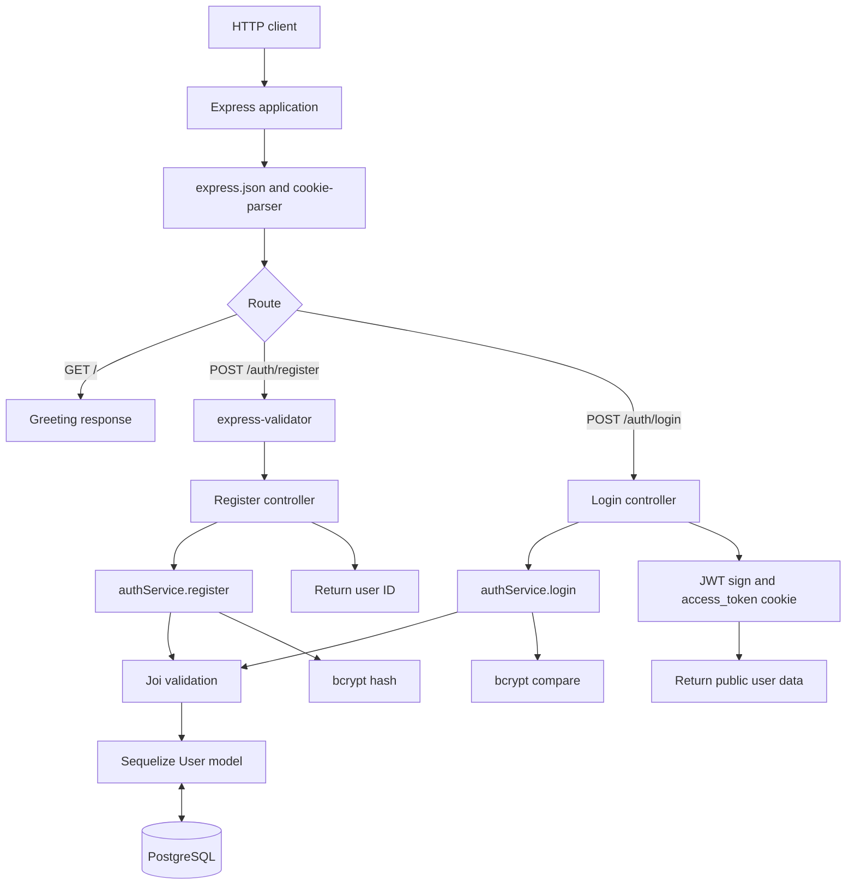

# Architecture and execution flow

This document describes the current codebase, not a future architecture proposal.

## Request and persistence flow

The diagram highlights the central components; database lookups and bcrypt operations take place in the service before a controller sends a response.

## Startup

Entry point: `src/index.js`.

1. Import `dotenv/config` and validate environment variables in `src/configs/env.js`.
2. Initialize the active PostgreSQL connector from `src/configs/db/postgresDB.js`.
3. Call `sequelize.authenticate()` followed by `sequelize.sync({ force: false })`.
4. Register JSON-body and cookie-parser middleware.
5. Mount `authRouters` under `/auth` and register `GET /`.
6. Register the centralized error middleware.
7. Start Express using the validated `PORT`.

If environment validation fails or the database cannot start, the code logs an error and exits the process.

## Modules

| Module | File | Responsibilities |
| --- | --- | --- |
| Bootstrap | `src/index.js` | Connection, middleware, routing, listen |
| Environment | `src/configs/env.js` | Joi schema for required env variables |
| Active connection | `src/configs/db/postgresDB.js` | PostgreSQL connection and model sync |
| Routes | `src/routers/authRouters.js` | POST registration and login |
| Controllers | `src/controller/` | HTTP request/response concerns |
| Business logic | `src/services/authServices.js` | Validation, user lookup, bcrypt operations |
| Data model | `src/models/postgres/userModel.js` | Sequelize `User` |
| Validation | `src/validations/` | Joi schemas and Express middleware |
| Error system | `src/errors/index.js`, `src/middlewares/errorHandler.js` | Custom error types and HTTP error responses |
| Optional / inactive code | `src/configs/db/mongoDB.js`, `src/models/mongo/userModel.js` | MongoDB implementation not used by the active server |
| Unregistered code | `src/middlewares/auth.middleware.js`, `src/middlewares/role.middleware.js`, `src/controller/userController.js` | Middleware/controllers currently not mounted on routes |

## Active data model

The PostgreSQL `User` model is defined in `src/models/postgres/userModel.js`:

| Field | Type | Notes |
| --- | --- | --- |
| `id` | Sequelize-generated primary key | Not explicitly declared in the model |
| `username` | STRING | Required / non-null |
| `password` | STRING | Required / non-null; stores bcrypt hash |
| `role` | STRING | Required / non-null; request chooses `user` or `admin` |
| `createdAt` / `updatedAt` | Date/time | Sequelize timestamps by default |

The model does not declare a database-level `unique` constraint on `username`. A check in the service rejects a preexisting username, but this is not equivalent to a unique index under concurrent registration requests.

## Registration flow

1. Request enters `POST /auth/register`.
2. Express-validator checks for nonempty username/password fields and password string type.
3. Controller passes `username`, `password`, and `role` to `authService.register`.
4. Joi enforces the service-level schema.
5. Service checks `User.findOne({ where: { username } })`.
6. Service hashes the password using bcrypt with configured `SALT_ROUNDS`.
7. Service creates a Sequelize record with the given role.
8. Controller responds with the newly generated `id` (HTTP 200).

The password hash, not the submitted plaintext password, is persisted.

## Login flow

1. Request enters `POST /auth/login`.
2. Controller delegates username/password verification to `authService.login`.
3. Joi validates both fields; Sequelize looks up the user by username.
4. bcrypt compares submitted password against the stored hash.
5. Service converts the Sequelize record to a plain object and removes `password`.
6. Controller calls `jwt.sign` for a one-hour token and sends `{ user }`.
7. JWT is included in a cookie called `access_token`.

**As implemented:** the JWT payload refers to `user._id`, but the service returns an object with Sequelize's `id` property. The token's `id` field therefore may be absent. No currently registered route validates this token.

## Error handling

The service throws instances of custom classes from `src/errors/index.js`. Controllers pass caught errors to Express's `next(error)`. The handler in `src/middlewares/errorHandler.js`:

- Accepts a numeric `statusCode` between 100 and 599, otherwise uses 500.
- Includes a stack trace in development responses.
- Suppresses stack traces in production and substitutes a generic message for unrecognized errors.

Some error definitions are inconsistent, as detailed in [Security & known limitations](SECURITY.md). The early Express-validator failure path independently returns a 403 error response.

## Boundaries and operational notes

- This is a single Express application rather than a microservice cluster.
- `MONGO_URI` is mandatory in the environment schema even though the active connection uses PostgreSQL.
- There is no caching layer, queue, third-party identity provider, or deployed API endpoint established by the repository.
- No automated tests or CI workflows are present in the reviewed tree.
- This documentation covers source-code behavior and does not claim runtime verification.

See [API reference](API.md) and [README](../README.md).

